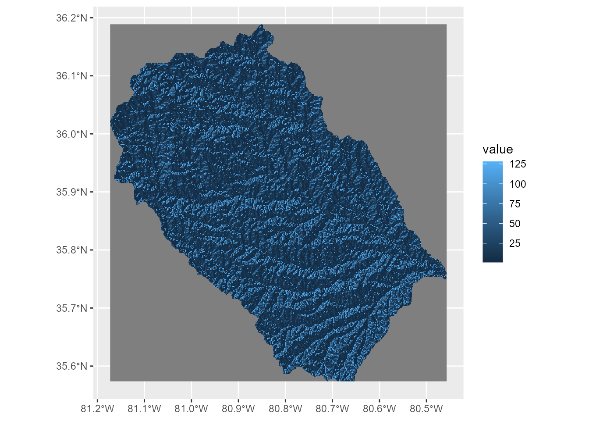
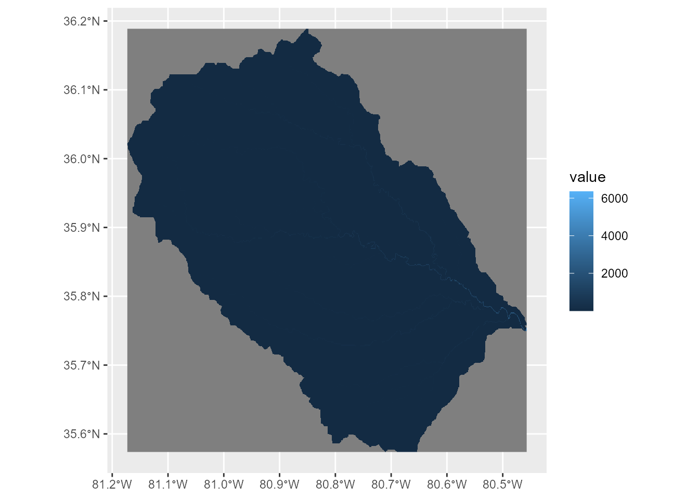
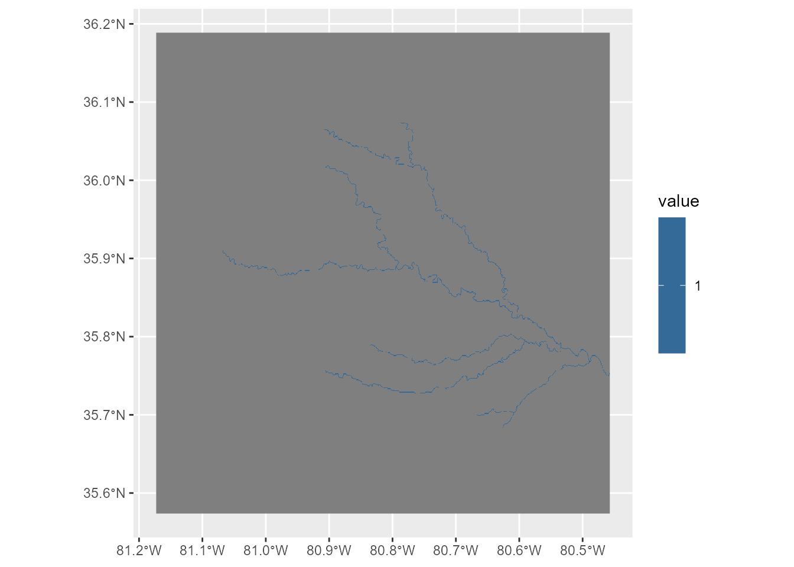
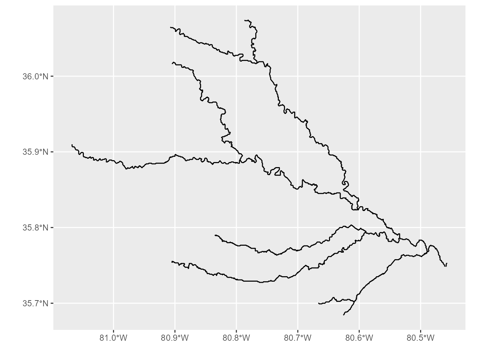
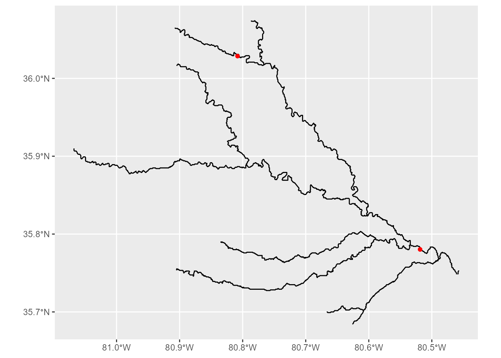
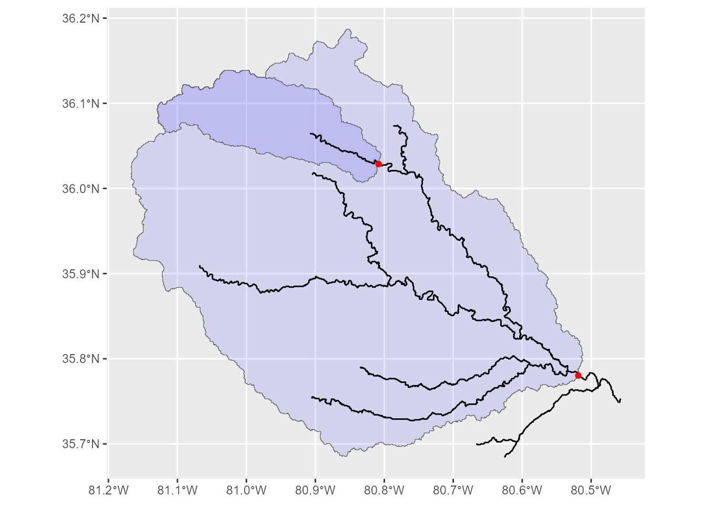
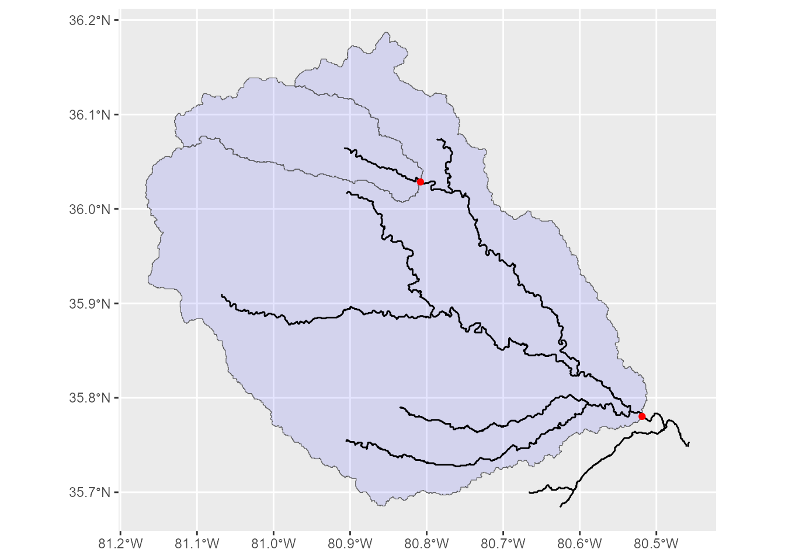

# Getting Started

## Introduction

The `wrapbox` package provides tools for extracting stream networks and
delineating watersheds using flow direction and flow accumulation
rasters. This is a wrapper package of `whitebox` (see [this package
website](https://whiteboxr.gishub.org/)).

This vignette demonstrates how to:

1.  Extract stream networks as raster grids from flow accumulation data.
2.  Convert stream grids into vector stream networks.
3.  Delineate unnested and nested watersheds using outlet locations.

The example data include a D8 flow direction raster (`dir.tif`; flow
directions are coded according to
[ArcGIS](https://pro.arcgis.com/en/pro-app/3.6/tool-reference/spatial-analyst/flow-direction.htm))
and an upstream area raster (`upa.tif`), both provided in the package.
These raster layers were derived from MeritHydro developed by [Yamazaki
et
al](https://agupubs.onlinelibrary.wiley.com/doi/10.1029/2019wr024873).

## 1. Load example data

First, load the required packages and example raster layers.

``` r

pacman::p_load(
  tidyverse,
  wrapbox,
  sf,
  terra,
  tidyterra
)
```

The example rasters are distributed in the `raster/` directory. Use
[`system.file()`](https://rdrr.io/r/base/system.file.html) to locate
them after installing the package.

``` r

## flow direction layer
dir_file <- system.file(
  "raster", "dir.tif",
  package = "wrapbox"
)

## flow accumulation layer
upa_file <- system.file(
  "raster", "upa.tif",
  package = "wrapbox"
)

f_dir <- terra::rast(dir_file)
f_acc <- terra::rast(upa_file)
```

Importantly, however, the flow direction layer must be converted to
Whitebox D8 scheme if source data is coded according to ArcGIS scheme;
otherwise, the Whitebox tools will not function properly and return
erroneous outputs.
[`wrapbox::arc2d8()`](https://aterui.github.io/wrapbox/reference/arc2d8.md)
function performs this conversion.

``` r

f_dir <- arc2d8(f_dir)
```

Inspect the raster properties.

``` r

f_dir
#> class       : SpatRaster
#> size        : 738, 859, 1  (nrow, ncol, nlyr)
#> resolution  : 0.0008333333, 0.0008333333  (x, y)
#> extent      : -81.17292, -80.45708, 35.57375, 36.18875  (xmin, xmax, ymin, ymax)
#> coord. ref. : lon/lat WGS 84 (EPSG:4326)
#> source(s)   : memory
#> varname     : dir
#> name        : n35w085_dir
#> min value   :           1
#> max value   :         128
f_acc
#> class       : SpatRaster
#> size        : 738, 859, 1  (nrow, ncol, nlyr)
#> resolution  : 0.0008333333, 0.0008333333  (x, y)
#> extent      : -81.17292, -80.45708, 35.57375, 36.18875  (xmin, xmax, ymin, ymax)
#> coord. ref. : lon/lat WGS 84 (EPSG:4326)
#> source      : upa.tif
#> name        : n35w085_upa
#> min value   :    0.006923
#> max value   : 6353.152832
```

The flow direction raster (`f_dir`) represents the direction of water
flow from each cell, whereas the flow accumulation raster (`f_acc`)
represents the upstream contributing area. These layers must use
compatible spatial extents, resolutions, and coordinate reference
systems.

Visualize the raster layers with
[`tidyterra::geom_spatraster()`](https://dieghernan.github.io/tidyterra/reference/geom_spatraster.html)
function:

``` r

## flow direction
ggplot() +
  geom_spatraster(data = f_dir)
#> <SpatRaster> resampled to 500528 cells.
```



``` r


## flow accumulation
ggplot() +
  geom_spatraster(data = f_acc)
#> <SpatRaster> resampled to 500528 cells.
```



## 2. Extract stream networks

### 2.1. Extract streams as a raster grid

Stream networks can be extracted by applying a threshold to the flow
accumulation raster.

The
[`flow2grid()`](https://aterui.github.io/wrapbox/reference/flow2grid.md)
function uses WhiteboxTools to identify cells whose upstream
contributing area exceeds a specified threshold.

``` r

# Define the minimum upstream contributing area
threshold <- 100

# Extract stream grid
str_grid <- flow2grid(
  f_acc = f_acc,
  threshold = threshold,
  output = tempfile(fileext = ".tif")
)
```

The threshold determines the minimum upstream contributing area for each
cell to be considered as an operational “stream.” Smaller thresholds
generally produce denser networks, whereas larger thresholds retain only
larger streams. The `output` argument determines the destination of
output file – although we used `tempfile(fileext = ".tif")` for this
example, users may specify the appropriate location in their repository.

**Note:** The threshold uses the units of the input flow accumulation
raster. Adjust it according to the spatial resolution and units of your
data.

Visualize the extracted stream grid.

``` r

ggplot() +
  geom_spatraster(data = str_grid)
#> <SpatRaster> resampled to 500528 cells.
```



### 2.2. Convert stream grids into vector networks

Stream grids can be converted into vector lines using
[`grid2stream()`](https://aterui.github.io/wrapbox/reference/grid2stream.md).

The function uses both the flow direction raster and the extracted
stream grid to reconstruct the stream network. Please ensure that the
flow direction layer conforms the formatting requirements of Whitebox
tools (see [1. Load example data](#load-example-data)).

``` r


str_vec <- grid2stream(
  f_dir = f_dir,
  str_grid = str_grid
)
```

The resulting object is an `sf` line layer, and visualization can be
done with `geom_sf()`.

``` r

ggplot() +
  geom_sf(data = str_vec)
```



An optional output path can be supplied to save the vector network.

``` r

str_vec <- grid2stream(
  f_dir = f_dir,
  str_grid = str_grid,
  output = "streams.gpkg"
)
```

## 3. Delineate watersheds

Watershed delineation requires outlet locations and a flow direction
raster.

Outlet locations should be placed on the stream network. By default,
[`wsd_unnested()`](https://aterui.github.io/wrapbox/reference/wsd_unnested.md)
and
[`wsd_nested()`](https://aterui.github.io/wrapbox/reference/wsd_nested.md)
snap outlet points to the nearest stream cells before delineating
watersheds.

### 3.1. Define outlet locations

For demonstration, we use a `sf` layer for outlet points. Like raster
data, the example data are distributed in the `vector/` directory. Use
[`system.file()`](https://rdrr.io/r/base/system.file.html) to locate
them.

``` r

## load outlet data file
outlet_file <- system.file(
  "vector", "outlet.rds",
  package = "wrapbox"
)

## load data
outlet <- readRDS(outlet_file)
  

## inspect
ggplot() +
  geom_sf(data = str_vec) +
  geom_sf(data = outlet,
          color = "red")
```



### 3.2. Unnested watershed delineation

The
[`wsd_unnested()`](https://aterui.github.io/wrapbox/reference/wsd_unnested.md)
function delineates independent watersheds for the supplied outlet
locations.

``` r

wsd <- wsd_unnested(
  outlet = outlet,
  id_col = "id",
  f_dir = f_dir,
  str_grid = str_grid,
  snap = TRUE,
  snap_dist = 5
)
#> Saving temporary files...
#> Snap outlet points to the nearest stream grid...
#> Delineate watersheds...
#> Vectorize raster watersheds...
#> Reading layer `outlet_snap' from data source 
#>   `C:\Users\a_terui\AppData\Local\Temp\Rtmp6rknBo\wsd_17928_46087c8772fd\outlet_snap.shp' 
#>   using driver `ESRI Shapefile'
#> Simple feature collection with 2 features and 2 fields
#> Geometry type: POINT
#> Dimension:     XY
#> Bounding box:  xmin: -80.80833 ymin: 35.78167 xmax: -80.5175 ymax: 36.03083
#> Geodetic CRS:  WGS 84
#> Registered S3 method overwritten by 'stars':
#>   method                  from
#>   st_interpolate_aw.stars sf
```

The resulting object is an `sf` polygon layer, with one watershed
polygon per outlet. The `snap_dist` argument specifies the maximum
distance for snapping outlet locations to the stream network, using the
map units of the input raster.

Since the resulting watershed polygons are overlapped with one another,
the watershed polygon for the upstream site has deeper color (if `alpha`
is less than `1`).

``` r

ggplot() +
  geom_sf(data = wsd,
          fill = "blue",
          alpha = 0.1) +
  geom_sf(data = str_vec) +
  geom_sf(data = outlet,
          color = "red")
```



### 3.3. Nested watershed delineation

Nested watersheds (i.e., watersheds are split into multiple polygons at
each outlet point) can be delineated using
[`wsd_nested()`](https://aterui.github.io/wrapbox/reference/wsd_nested.md).

``` r

wsd_nested <- wsd_nested(
  outlet = outlet,
  id_col = "id",
  f_dir = f_dir,
  str_grid = str_grid,
  snap = TRUE,
  snap_dist = 5
)
#> Saving temporary files...
#> Snap outlet points to the nearest stream grid...
#> Delineate watersheds...
#> Vectorize raster watersheds...
#> Reading layer `outlet_snap' from data source 
#>   `C:\Users\a_terui\AppData\Local\Temp\Rtmp6rknBo\wsd_17928_46086162a9a\outlet_snap.shp' 
#>   using driver `ESRI Shapefile'
#> Simple feature collection with 2 features and 2 fields
#> Geometry type: POINT
#> Dimension:     XY
#> Bounding box:  xmin: -80.80833 ymin: 35.78167 xmax: -80.5175 ymax: 36.03083
#> Geodetic CRS:  WGS 84
```

The resulting watershed polygons represent nested, non-overlapping
drainage areas associated with their respective outlet locations.
Because the polygons do not overlap, plotting them with transparent
fills does not produce any color variation.

``` r

ggplot() +
  geom_sf(data = wsd_nested,
          fill = "blue",
          alpha = 0.1) +
  geom_sf(data = str_vec) +
  geom_sf(data = outlet,
          color = "red")
```



## 4. Summary

The main functions are:

| Function | Input | Output |
|:---|:---|:---|
| [`flow2grid()`](https://aterui.github.io/wrapbox/reference/flow2grid.md) | Flow accumulation | Stream grid |
| [`grid2stream()`](https://aterui.github.io/wrapbox/reference/grid2stream.md) | Flow direction and stream grid | Vector streams |
| [`wsd_unnested()`](https://aterui.github.io/wrapbox/reference/wsd_unnested.md) | Outlet points and flow direction | Unnested watersheds |
| [`wsd_nested()`](https://aterui.github.io/wrapbox/reference/wsd_nested.md) | Outlet points and flow direction | Nested watersheds |

For additional details about function arguments and implementation, see
the package reference documentation.
